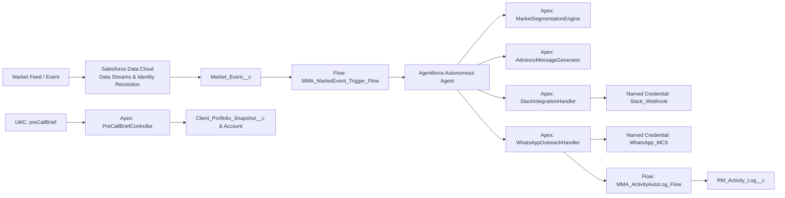

# Market-Monitoring-Agentforce

AI-driven Wealth Management Agentforce solution built on **Salesforce Financial Services Cloud (FSC)**, **Data Cloud**, **Apex**, **Lightning Web Components (LWC)**, **Flows**, and **Slack / WhatsApp** integrations.

## Business Use Case

During periods of sudden market volatility, Relationship Managers (RMs) struggle to quickly identify which high-net-worth clients are most exposed, calculate portfolio impact ("AUM at Risk"), and deliver personalized, compliant outreach before clients panic.

**Market-Monitoring-Agentforce** automates this end-to-end workflow:
1. **Event Detection & Ingestion:** Market events are captured in Salesforce (`Market_Event__c`) and enriched with Data Cloud streams and identity resolution.
2. **Autonomous Segmentation:** An Agentforce agent evaluates client portfolio exposure (`Client_Portfolio_Snapshot__c`), risk profiles, and communication preferences (`Client_Comm_Preference__c`).
3. **360-Degree Pre-Call Brief:** RMs view an interactive LWC (`preCallBrief`) surfacing client exposure, talking points, and recommended next-best actions.
4. **Omni-Channel Outreach & Logging:** RMs receive automated Slack alerts (`Slack_Webhook`) and can trigger personalized WhatsApp outreach (`WhatsApp_MCS`) with automatic activity logging (`RM_Activity_Log__c`).

## Architecture

### Agentforce & Data Cloud Architecture

- **Data Cloud:** Ingests real-time market feeds and portfolio snapshots, performs Identity Resolution across household/client accounts, and computes Calculated Insights (e.g., sector exposure and AUM at Risk).
- **Agentforce:** Orchestrates autonomous reasoning topics that invoke Apex `@InvocableMethod` actions to segment impacted clients, draft advisory messages, and notify RMs.



## Salesforce Financial Services Cloud Data Model

| Object / Target | Purpose |
| --- | --- |
| `Market_Event__c` | Stores market volatility events, affected sectors/tickers, severity, and event timestamps. |
| `Client_Portfolio_Snapshot__c` | Captures point-in-time client holdings, AUM, sector allocation, and exposure metrics. |
| `Client_Comm_Preference__c` | Tracks client opt-ins, preferred outreach channel (WhatsApp, Email, Phone), and quiet hours. |
| `RM_Activity_Log__c` | Audits RM alerts, generated advisory briefs, and outbound client communications. |
| `Account` (Custom Fields) | Extends FSC Client/Household Accounts with wealth tier, risk tolerance, and RM assignment fields. |

## Technical Components

### Apex Classes (`@InvocableMethod` & Controllers)
- `MarketSegmentationEngine`: `@InvocableMethod` class that filters and prioritizes impacted clients based on AUM at Risk and portfolio exposure.
- `AdvisoryMessageGenerator`: `@InvocableMethod` class that drafts personalized client advisory messaging.
- `PreCallBriefController`: Controller (with `@AuraEnabled` / `@InvocableMethod` support) backing the `preCallBrief` LWC with client portfolio and event context.
- `SlackIntegrationHandler`: `@InvocableMethod` handler posting real-time RM alert payloads to Slack.
- `WhatsAppOutreachHandler`: `@InvocableMethod` handler dispatching personalized WhatsApp messages to opted-in clients.

### Lightning Web Components (LWC)
- `preCallBrief`: Displays a 360-degree RM relationship brief on Account/Client pages with exposure metrics and recommended talking points.

### Flows
- `MMA_MarketEvent_Trigger_Flow`: Record-triggered Flow on `Market_Event__c` that initiates segmentation and Agentforce/RM notifications.
- `MMA_ActivityAutoLog_Flow`: Automates creation of `RM_Activity_Log__c` records following client outreach.

### Named Credentials
- `Slack_Webhook`: Stores the endpoint and authentication configuration for Slack incoming webhook alerts.
- `WhatsApp_MCS`: Stores the endpoint and credentials for WhatsApp Business / Messaging Cloud Service outreach.

## SFDX Setup Guide

### Prerequisites
- Salesforce CLI (`sf` / `sfdx`) installed
- Target Salesforce org with **Financial Services Cloud**, **Data Cloud**, and **Agentforce** enabled

### Deployment Steps
1. **Clone the repository:**
   ```bash
   gh repo clone 23H51A62B9/Market-Monitoring-Agentforce
   cd Market-Monitoring-Agentforce
   ```
2. **Authenticate to your Salesforce org:**
   ```bash
   sf org login web --alias mma-org
   ```
3. **Deploy metadata:**
   ```bash
   sf project deploy start --source-dir force-app --target-org mma-org
   ```
4. **Configure Named Credentials:**
   - In Setup -> **Named Credentials**, update `Slack_Webhook` with your Slack webhook URL.
   - Update `WhatsApp_MCS` with your WhatsApp API endpoint and token.
5. **Seed sample data (optional):**
   - Execute `data-generator.apex` via Anonymous Apex to populate sample clients, snapshots, and market events.
6. **Activate Flows & Agentforce:**
   - Activate `MMA_MarketEvent_Trigger_Flow` and `MMA_ActivityAutoLog_Flow` in Flow Builder.
   - Complete the manual Data Cloud and Agentforce configuration noted below.

## Implemented vs. Planned

### Implemented
- Core FSC custom objects (`Market_Event__c`, `Client_Portfolio_Snapshot__c`, `Client_Comm_Preference__c`, `RM_Activity_Log__c`) and `Account` custom fields.
- Apex classes: `MarketSegmentationEngine`, `AdvisoryMessageGenerator`, `PreCallBriefController`, `SlackIntegrationHandler`, `WhatsAppOutreachHandler`.
- LWC `preCallBrief`, Flows (`MMA_MarketEvent_Trigger_Flow`, `MMA_ActivityAutoLog_Flow`), and Named Credentials (`Slack_Webhook`, `WhatsApp_MCS`).
- Sample data generator (`data-generator.apex`) and SFDX project configuration (`sfdx-project.json`).

### Planned / Known Gaps
- **Einstein API Integration (`AdvisoryMessageGenerator.cls`):** Currently uses an Einstein API stub comment for message generation; live Einstein Generative AI / Models API callout integration is planned.
- **Crash Simulation (`PreCallBriefController.cls`):** The `simulateMarketCrash` method referenced for interactive stress-testing in the UI is not yet implemented in `PreCallBriefController.cls`.
- **Manual Post-Deploy Agentforce & Data Cloud Setup:** Data Cloud Data Streams, Identity Resolution rulesets, Calculated Insights, and Agentforce Agent Topics/Actions must be configured and activated manually in the target org after SFDX metadata deployment.
